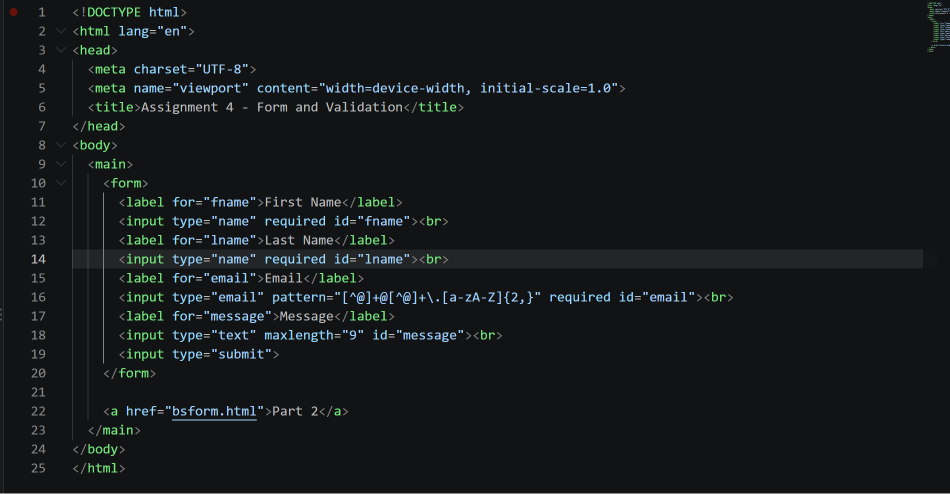
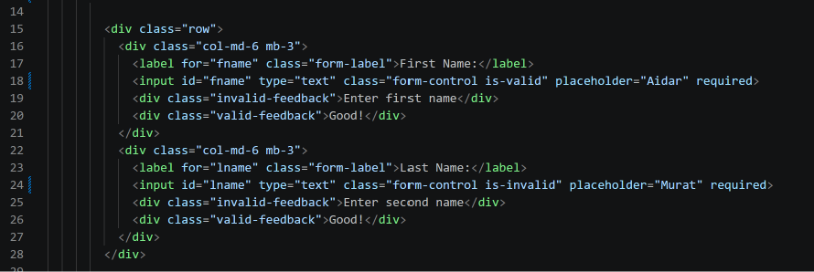
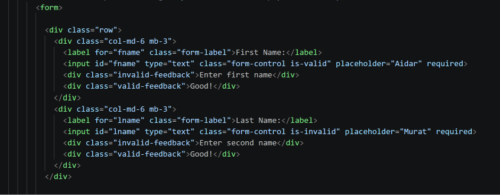
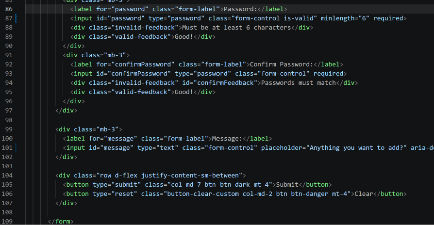
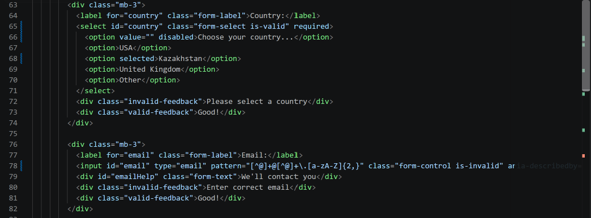

# Assignment 4 — HTML and Bootstrap Forms

**Name:** Aidar Murat  
**Group:** SE - 2539

## Part 1. Basic HTML Forms

### Task 0. Simple Contact Form
Created a basic contact form with labeled fields for first name, last name, email, and message, along with a submit button.

### Task 1. Form with HTML5 Validation
Added HTML5 validation attributes to the form, including required fields, email validation, and a maximum message length.

## Part 2. Bootstrap Forms

### Task 2. Bootstrap Form Styling
Recreated and styled the form with Bootstrap form classes and grid layout, including placeholders and helper text.

### Task 3. Bootstrap Validation Styles
Used Bootstrap validation styles and feedback messages to show valid and invalid form states.

## Part 3. Advanced Form Project

### Task 4. Registration Form
Created a responsive registration form using Bootstrap Grid, HTML5 validation, and Bootstrap validation feedback. The form includes personal details, gender and hobby selections, country, email, password, password confirmation, and an optional message.

## Summary of Work Process
I built the forms in stages, starting with a basic HTML contact form and adding browser validation. I then styled the form with Bootstrap and added validation feedback states. Finally, I created a responsive registration form with additional fields and password requirements. Screenshot placeholders are included above for each task.
